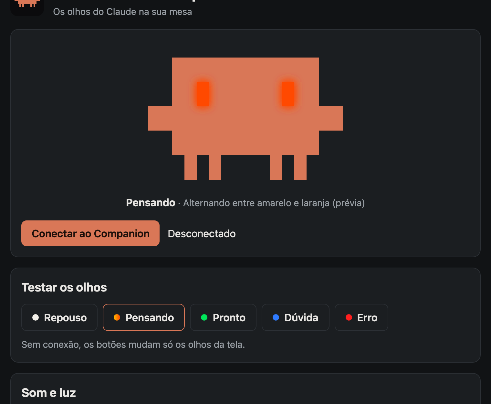

mpa<p align="center"></p>

<h1 align="center">Claude Code Companion</h1>

<p align="center">O mascote do <strong>Claude Code</strong> na sua mesa, com olhos de LED que mostram, por Bluetooth, o
que ele está fazendo.<br>
<a href="https://patogordo.github.io/ClaudeCodeCompanion/">patogordo.github.io/ClaudeCodeCompanion</a></p>

---

O corpo é o mascote em pixel art, impresso em 3D. Os olhos são as duas janelinhas dele, com LEDs atrás de um difusor
branco: em repouso ficam brancos. Enquanto o Claude pensa, alternam entre amarelo e laranja. Quando ele termina, ficam
verdes e tocam um som. Se ele tiver uma dúvida, ficam azuis. Se algo der errado, ficam vermelhos e tocam outro som. Dá
para tirar os olhos da tela e ainda saber a hora de voltar.

> **Projeto pessoal, sem fins comerciais.** É um hobby, feito para uso próprio e sem intenção de venda. O mascote do
> Claude Code e os nomes Claude e Claude Code pertencem à Anthropic, e reconheço isso: este projeto não tem nenhuma
> relação com a Anthropic, nem é apoiado ou endossado por ela. Se a Anthropic quiser a remoção de qualquer parte, basta
> entrar em contato pelo [GitHub](https://github.com/patogordo) ou abrir uma
> [issue](https://github.com/patogordo/ClaudeCodeCompanion/issues), e eu removo.

<p align="center">
  
</p>

## Os estados

| Olhos | Som | Quando |
| --- | --- | --- |
| Brancos (LEDs apagados atrás do difusor) | | A sessão abre ou fecha, ou você dá um toque curto no botão |
| Alternando entre amarelo e laranja | | Você manda um prompt, e a cada ferramenta que o Claude usa |
| Verde | Dois bipes subindo | O Claude termina a resposta |
| Azul pulsando | | O Claude pede permissão, faz uma pergunta ou apresenta um plano |
| Vermelho | Dois bipes descendo | Um comando falha ou a API dá erro |

Ligar e desligar: segure o botão por 1 s. Ao ligar, os olhos abrem em branco, piscam duas vezes e se apagam devagar,
com uma escala subindo; ao desligar, acendem em branco, a pálpebra fecha de cima para baixo e a escala desce.

## Como funciona

```
Claude Code ── hooks ──► companion send … ── UDP ──► ponte BLE ──┐
                                                                 ├──► Companion (XIAO ESP32-C3)
Portal no navegador ───────────── Web Bluetooth ─────────────────┘
```

- **Firmware** (`firmware/`): Seeed XIAO ESP32-C3, dois LEDs atrás de cada olho, buzzer, botão e bateria que carrega
  pelo USB-C. Tem dois **superpoderes**: três pinos na cabeça que continuam a corrente de LEDs (um chapéu de Natal com LEDs
  acende junto com os olhos) e um conector Qwiic nas costas para acessórios I2C. Peças e ligações em
  [`docs/hardware.md`](docs/hardware.md).
- **Plugin do Claude Code** (`plugin/`): hooks que mandam o estado a cada passo, sem nunca fazer o Claude esperar, e uma
  ponte em Python (bleak) que segura a conexão BLE para todas as sessões. Tem também uma skill: peça ao Claude
  "abaixa o volume do companion" ou "quanto tem de bateria?".
- **Portal** (`app/`): página que conecta pelo Web Bluetooth e mostra os olhos ao vivo, a bateria e os superpoderes;
  ajusta volume e brilho, testa os estados e desliga. Funciona ao mesmo tempo que o plugin.

O protocolo (UUIDs, comandos, status) está em [`docs/protocolo.md`](docs/protocolo.md).

## Simular no Wokwi

Precisa do [arduino-cli](https://arduino.github.io/arduino-cli/) com o core do ESP32 e a biblioteca Adafruit
NeoPixel, e do [wokwi-cli](https://docs.wokwi.com/wokwi-ci/cli-installation) com um token em `WOKWI_CLI_TOKEN`.

```bash
arduino-cli config add board_manager.additional_urls https://espressif.github.io/arduino-esp32/package_esp32_index.json
arduino-cli core install esp32:esp32
arduino-cli lib install "Adafruit NeoPixel"

pnpm firmware   # compila para firmware/build
pnpm sim        # roda no terminal: digite thinking, done, question, error, vol 30, status...
pnpm sim:test   # liga, obedece, desliga e liga de novo (firmware/test.scenario.yaml)
```

### No VS Code, vendo os olhos

1. Com a extensão [Wokwi Simulator](https://marketplace.visualstudio.com/items?itemName=wokwi.wokwi-vscode), abra a
   pasta do firmware: `code firmware`. Na primeira vez, `F1` → **Wokwi: Request a New License** (grátis, pelo
   navegador).
2. `pnpm firmware`, depois `F1` → **Wokwi: Start Simulator**. Os olhos são os quatro NeoPixels (dois por olho), e o
   chapéu é a fita de cima.
3. No terminal da serial, digite `thinking`, `done`, `question`, `error`, `vol 30`... O botão vermelho (ou a tecla `P`,
   com o simulador em foco) liga e desliga segurando 1 s.

O simulador não tem difusor: em repouso, o LED aparece escuro, e não branco. Também dá para criar um projeto em
[wokwi.com](https://wokwi.com) com o `firmware.ino` (como `sketch.ino`), o `diagram.json` e o `libraries.txt`.

### Com o Claude de verdade mexendo nos olhos

O Wokwi não simula o rádio Bluetooth, mas o `wokwi.toml` publica a serial simulada na porta TCP 4000, e a ponte do
plugin sabe falar com ela. Com o simulador rodando (no VS Code ou com `pnpm sim`):

```bash
claude plugin marketplace add .
claude plugin install companion@companion --scope local   # só neste projeto
```

e, em `.claude/settings.local.json`, `{"env": {"COMPANION_SIM": "localhost:4000"}}`. Abra o Claude Code nesta pasta e
peça qualquer coisa: os olhos do simulador acompanham cada passo. Se uma ponte Bluetooth já estiver rodando de outra
sessão, pare antes (`pkill -f "companion bridge"`).

## Gravar no XIAO

```bash
pnpm firmware
arduino-cli upload -p /dev/cu.usbmodem* --fqbn esp32:esp32:XIAO_ESP32C3 firmware
```

## Ligar ao Claude Code

```bash
claude plugin marketplace add patogordo/ClaudeCodeCompanion
claude plugin install companion@companion
```

Abra o Claude Code. Na primeira sessão, o plugin sobe a ponte em segundo plano (com o [uv](https://docs.astral.sh/uv/),
que baixa o bleak sozinho; sem o uv, rode `pip install bleak`). No macOS, permita o Bluetooth para o terminal quando o
sistema pedir. Daí em diante, ligue o Companion perto do computador e ele conecta sozinho.

Se algo não acender: `~/.cache/claude-companion/bridge.log` diz o que a ponte está vendo, e `companion status` (pelo
Claude, com a skill) mostra se o Companion está conectado.

## Portal

```bash
pnpm install
pnpm dev        # http://localhost:3500
```

Use o Chrome ou o Edge, no computador ou no Android: Safari, Firefox e iPhone não têm Web Bluetooth. O portal está
publicado em [patogordo.github.io/ClaudeCodeCompanion](https://patogordo.github.io/ClaudeCodeCompanion/): o workflow
`.github/workflows/pages.yml` roda formatação, tipos e testes em todo push e publica na `main`. Em outro lugar,
`pnpm generate` gera um site estático em `.output/public`, que precisa de HTTPS (o Web Bluetooth exige).

## Onde fica cada coisa

| Caminho | Conteúdo |
| --- | --- |
| `firmware/firmware.ino` | Firmware: olhos, sons, botão, bateria, BLE e serial |
| `firmware/diagram.json`, `wokwi.toml`, `test.scenario.yaml` | Circuito, configuração e teste do Wokwi |
| `plugin/` | Plugin do Claude Code: `hooks/hooks.json`, a ponte `bin/companion` e a skill `skills/companion` |
| `.claude-plugin/marketplace.json` | Marketplace local, para instalar o plugin desta pasta |
| `app/app.vue` | O portal |
| `shared/protocol.ts` | UUIDs, estados e validação do status, usados pelo portal e pelos testes |
| `tests/` | Confere que firmware, plugin e portal falam o mesmo protocolo |
| `docs/` | Hardware, protocolo e capturas de tela |
| `public/` | Logo e ícones |

## Licença

O código é MIT. O mascote e as marcas Claude e Claude Code são da Anthropic e não fazem parte da licença (veja o aviso
no começo desta página).
