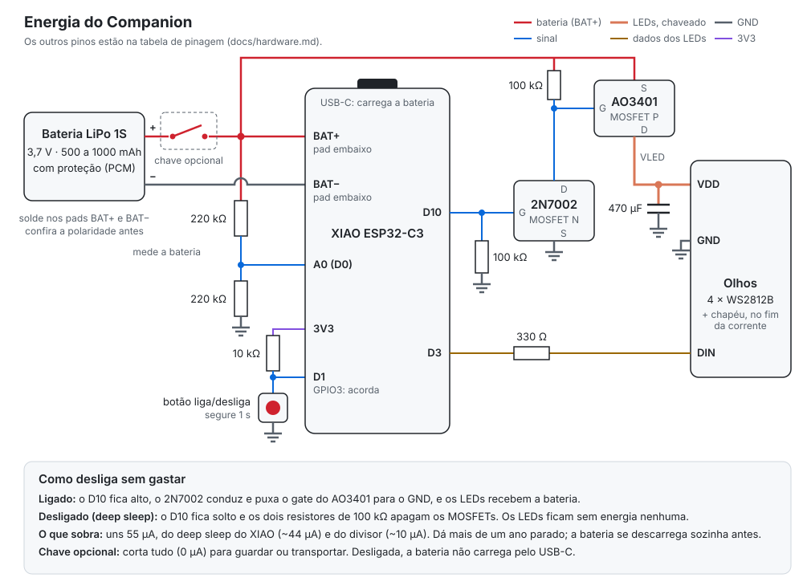

# Hardware

O corpo é o mascote do Claude Code em pixel art, impresso em 3D. Os olhos são as duas janelinhas dele, fechadas com um
difusor branco, com dois LEDs atrás de cada uma: apagados, os olhos ficam brancos; acesos, ficam da cor do estado.
Dentro, um Seeed XIAO ESP32-C3, um buzzer, um botão e uma bateria que carrega pelo USB-C do próprio XIAO. O diagrama do
Wokwi (`firmware/diagram.json`) é a versão simplificada deste circuito; as diferenças estão no fim da página.

## Peças

| Peça | Qtd. | Para quê |
| --- | --- | --- |
| Seeed Studio XIAO ESP32-C3 | 1 | O cérebro. Use a antena que vem junto: sem ela o Bluetooth fica fraco |
| Corpo, tampa, difusores e tampinhas dos olhos, impressos em 3D | 1 jogo | `3d/*.stl`: 128 × 80 × 52 mm, olhos de 8 × 16 mm. Material, cores e montagem em [`impressao-3d.md`](impressao-3d.md) |
| Fita WS2812B de 144 LEDs/m | 2 pedaços de 2 LEDs | Um pedaço em cada olho, um LED em cima do outro, colado na tampinha do tubo de luz |
| Mini protoboard de 170 furos | 1 | Cabe no chão do corpo. Para a versão final, placa perfurada soldada |
| Adaptador SOT-23 para DIP | 2 | Para usar os MOSFETs (que são SMD) na protoboard |
| Parafuso M2 × 8 autoatarraxante | 4 | Fecham a tampa |
| Bateria LiPo 1S 3,7 V, 500 a 1000 mAh, com proteção | 1 | Soldada nos pads BAT+ e BAT− embaixo do XIAO, que carrega pelo USB-C |
| Buzzer piezo passivo de 12 mm | 1 | Os sons. Piezo puxa pouca corrente e vai direto no pino; buzzer magnético precisa de transistor |
| Botão de pulso de painel, 7 mm | 1 | Liga e desliga, na tampa de trás |
| MOSFET P AO3401 e MOSFET N 2N7002 | 1 + 1 | Cortam a alimentação dos LEDs com o Companion desligado |
| Resistor 220 kΩ | 2 | Divisor para medir a bateria |
| Resistor 100 kΩ | 2 | Pull-up do gate do AO3401 e pull-down do gate do 2N7002 |
| Resistor 10 kΩ | 1 | Pull-up do botão (o interno do C3 não é garantido no deep sleep) |
| Resistor 330 Ω | 1 | Em série no fio de dados dos LEDs |
| Capacitor eletrolítico 470 µF, 6,3 V | 1 | No VLED, perto do primeiro anel |
| Barra de pinos fêmea de 3 vias | 1 | Superpoder da cabeça |
| Conector JST-SH de 4 vias (Qwiic) | 1 | Superpoder das costas |

## Pinagem

Nos pinos, use os nomes `Dx` do XIAO: o número cru é o GPIO (`7` é o GPIO7, que é o D5).

| Pino | GPIO | Ligação |
| --- | --- | --- |
| D0 (A0) | 2 | Meio do divisor 220 kΩ + 220 kΩ entre BAT+ e GND |
| D1 | 3 | Botão para o GND, com 10 kΩ para o 3V3. Só os GPIO0 a 5 acordam o C3 do deep sleep |
| D2 | 4 | Buzzer (o outro terminal no GND) |
| D3 | 5 | 330 Ω até o DIN do LED de cima do olho esquerdo. A corrente segue: olho esquerdo (cima, baixo), olho direito (cima, baixo), superpoder da cabeça |
| D4 | 6 | SDA do superpoder das costas |
| D5 | 7 | SCL do superpoder das costas |
| D10 | 10 | Gate do 2N7002, com 100 kΩ para o GND |
| D6, D7 | 21, 20 | Livres. São a UART0, onde o boot escreve o log: LED aqui pisca lixo ao ligar |
| D8, D9 | 8, 9 | Livres. São pinos de strapping (o D9 é o botão BOOT): um LED apagado no fio puxaria o pino e o C3 não daria boot |

Os 4 LEDs dos olhos e os do chapéu ficam numa corrente só, num fio de dados só. No firmware, `EYE_PIXELS` é quantos
LEDs cada olho tem (de cima para baixo) e `HAT` é onde o chapéu começa (`firmware/firmware.ino`).

## Energia

1. **Bateria:** solde o fio vermelho (+) no pad BAT+ e o preto (−) no BAT−, os dois embaixo do XIAO. Confira a
   polaridade com um multímetro antes: conectores JST de bateria não têm padrão entre fabricantes, e o XIAO não tem
   proteção contra inversão. O USB-C do próprio XIAO carrega a bateria e, plugado, alimenta tudo.
2. **Medição:** dois resistores de 220 kΩ em série entre o BAT+ e o GND, com o meio no A0.
3. **Botão:** entre o D1 e o GND, com 10 kΩ do D1 para o 3V3.
4. **Corte dos LEDs:** o AO3401 (MOSFET P) fica entre o BAT+ e o VLED, que alimenta os olhos, o chapéu e o capacitor de
   470 µF. O gate dele tem 100 kΩ para o BAT+ e vai ao dreno do 2N7002 (MOSFET N), que tem a fonte no GND e o gate no
   D10, com 100 kΩ para o GND.
5. **Chave de transporte (opcional):** uma chave deslizante no fio + da bateria corta tudo. Desligada, a bateria não
   carrega pelo USB-C.

Ligado, o firmware põe o D10 em nível alto: o 2N7002 conduz, puxa o gate do AO3401 para o GND e os LEDs recebem a
bateria. Desligado, o C3 entra em deep sleep, o D10 fica solto e os dois resistores de 100 kΩ apagam os MOSFETs. Sem
esse corte, cada WS2812B apagado ainda consome perto de 1 mA: os 4 dos olhos e um chapéu esvaziariam uma bateria de
500 mAh em poucos dias, com o Companion desligado. Com ele, desligado fica em dezenas de µA (o deep sleep do C3 e os
10 µA do divisor), o que dá meses. Ligado, o repouso deixa os LEDs apagados, então quem mais gasta é o tempo em que o
Claude está trabalhando.

O conector das costas pega o 3V3 do XIAO, que continua ligado no deep sleep: um acessório com LED de power (comum nas
plaquinhas Qwiic) gasta com o Companion desligado. Corte o jumper do LED do acessório ou use a chave de transporte.

Ligado, o C3 com o Bluetooth gasta dezenas de mA, e os LEDs acesos somam mais: na mesa, deixe no USB-C, que carrega
enquanto usa.

Os LEDs vão na bateria, não no pino 5V: o 5V do XIAO só tem tensão com o USB ligado. Com a bateria cheia (4,2 V), o dado
de 3,3 V fica no limite do que o WS2812B entende como nível alto; se os olhos piscarem cores erradas, ponha um 74AHCT125
como conversor de nível no fio de dados.

Abaixo de 3,3 V, por três leituras seguidas (uma a cada 10 s), o Companion desliga sozinho para não descarregar a LiPo
demais. A porcentagem é uma reta entre 3,3 V e 4,15 V: serve de indicação, não de medida. Com o USB ligado, a leitura
sobe porque a bateria está carregando.

## Botão

- **Ligar:** segure por 1 s. Os olhos abrem em branco, de baixo para cima, piscam duas vezes e se apagam devagar, com
  uma escala subindo. Um toque rápido acorda o C3, mas ele volta a dormir sem acender nada.
- **Desligar:** segure por 1 s. Os olhos acendem em branco e a pálpebra fecha, de cima para baixo, com a escala
  descendo.
- **Toque curto, ligado:** volta os olhos ao repouso (apaga o verde ou o vermelho).

## Superpoderes

**Cabeça:** três pinos (VLED, dados, GND) que continuam a corrente dos olhos. Qualquer LED endereçável WS2812B ou
SK6812 ligado ali acende junto com os olhos, até 16 LEDs (`HAT_PIXELS`): um chapéu de Natal com uma fita de LEDs na
aba, uma antena, uma coroa. Sem nada ligado, os dados saem pelo fim da corrente e nada acontece.

**Costas:** conector Qwiic/STEMMA QT (GND, 3V3, SDA no D4, SCL no D5), o padrão de sensores e telinhas I2C da
SparkFun e da Adafruit. No boot, o firmware procura o que está ligado e mostra os endereços no portal e no
`companion status` (por exemplo, `0x3C` é um display OLED). O que o acessório faz fica por conta do firmware: escreva o
código em `firmware/firmware.ino`.

## No Wokwi

O diagrama simplifica o circuito:

- Cada olho são dois NeoPixels, um em cima do outro. O simulador não tem difusor: apagado, o LED fica escuro, e não
  branco.
- Os LEDs ficam no pino 5V, sem MOSFET (o simulador não gasta bateria).
- O A0 vai no GND: sem bateria, o status mostra `"bat":-1`.
- O chapéu é uma fita de 8 LEDs no fim da corrente.
- O Wokwi não simula o rádio Bluetooth: o firmware sobe o BLE, mas nada conecta. Os comandos vão pela serial, com o
  mesmo texto do BLE. O `wokwi.toml` publica essa serial na porta TCP 4000, e a ponte do plugin fala com ela quando
  `COMPANION_SIM=localhost:4000` (veja o README).
