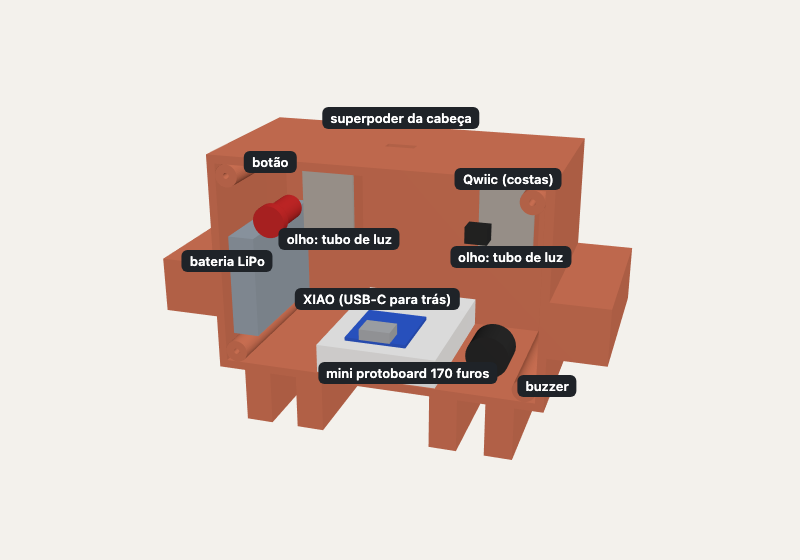

# Impressão 3D

O corpo é o mascote do Claude Code em pixel art, oco, com 128 × 80 × 52 mm montado (16 × 10 pixels de 8 mm). Os STL
estão em `3d/` e saem do script `3d/gerar.py`, já na posição de imprimir: **nenhuma peça precisa de suporte**.

<p align="center">
  
  
</p>

## Peças

| Arquivo | Cor | Na mesa |
| --- | --- | --- |
| `corpo.stl` | Laranja | Com o rosto para baixo. O rosto pega a textura da mesa (numa PEI texturizada fica fosco e bonito) |
| `tampa.stl` | Laranja | Com o lado de fora para baixo |
| `difusores.stl` (os 2 olhos) | Branco | Com a aba para baixo |
| `tampas-dos-olhos.stl` (as 2) | Qualquer; branco reflete mais luz | Deitadas |

O corpo tem 128 × 80 × 50 mm na mesa e cabe em qualquer impressora, até numa de 180 × 180 mm.

**Tudo de uma vez:** `mesa.stl` traz as quatro peças de um Companion lado a lado, em 210 × 154 mm (cabe em qualquer
Anycubic Kobra, a partir de 220 × 220 mm). No fatiador (Anycubic Slicer Next, Orca, Bambu Studio), use **Dividir →
Para objetos** para separar as peças. Com multicor (o ACE da Anycubic), dê o branco aos difusores. Sem multicor,
imprima os difusores à parte, em branco, ou só a `mesa.stl` sem eles. Para 3 Companions, são 3 impressões: três corpos
não cabem juntos nem numa mesa de 250 mm.

## Material e cores

- **PLA fosco (matte)** em tudo: não empena, imprime fácil, e o fosco esconde as camadas, combinando com o pixel art.
  Se o Companion for ficar no sol ou num lugar quente, use PETG (o PLA amolece perto de 55 °C).
- **Corpo e tampa:** laranja terracota, o mais perto possível do laranja do mascote (`#D97757`). Procure por
  "terracota", "coral" ou "laranja queimado" fosco; laranja vivo demais fica parecendo cone de trânsito.
- **Difusores:** PLA **branco**, não o "natural" translúcido. Apagado, o olho fica branco, como você quer; aceso, o
  branco espalha a luz por igual. Com 2 mm passa luz de sobra. Se achar fraco, aumente o brilho no portal ou diminua
  `FACE` no `gerar.py` (o rosto e o difusor afinam juntos).
- **Com impressora multicor** (AMS ou troca de filamento na camada), dá para imprimir os olhos brancos junto com o
  rosto, sem os difusores avulsos.

## Configurações

| Ajuste | Valor |
| --- | --- |
| Altura de camada | 0,2 mm (bico de 0,4 mm) |
| Paredes (perímetros) | 3 |
| Camadas de topo e de fundo | 4 |
| Preenchimento | 15%, giroide (só os braços e as pernas, que são maciços, usam) |
| Suportes | Nenhum |
| Brim | Não precisa |

As espessuras já vêm do modelo: paredes de 2,4 mm nos lados, no topo e no chão, e 2 mm no rosto e na tampa. Com 3
perímetros elas saem praticamente sólidas. A única ponte é o rasgo do superpoder da cabeça (8,4 mm), que qualquer
impressora faz.

## Onde vai cada componente

<p align="center">
  
</p>

Visto por trás, com a tampa aberta:

- **Olhos:** atrás de cada janela há um tubo de luz. Encaixe o difusor por dentro, com a aba para trás, e prenda a
  aba com uma gota de cola. Cole um pedaço de 2 LEDs de fita WS2812B de 144 LEDs/m no lado de dentro da tampinha do
  olho, com os LEDs virados para o difusor (ficam a uns 5 mm dele) e a entrada de dados (DIN) em cima. O fio sai pelo
  entalhe da tampinha. Cole a tampinha no tubo.
- **Ordem dos LEDs:** D3 → olho que fica à esquerda de quem olha de frente (cima, baixo) → o outro olho (cima, baixo)
  → superpoder da cabeça. Por trás, o primeiro olho é o da direita.
- **Mini protoboard de 170 furos:** no chão, no meio, encostada na tampa. A fita dupla face que vem embaixo dela
  segura.
- **XIAO:** na ponta de trás da protoboard, com o USB-C virado para a tampa. Ele sai pelo furo de baixo, no meio.
- **MOSFETs, resistores e capacitor:** na protoboard. O AO3401 e o 2N7002 são SMD (SOT-23): use um adaptador SOT-23
  para DIP em cada um.
- **Bateria:** em pé, na parede da esquerda, com fita dupla face de espuma. Uma 803040 (8 × 30 × 40 mm, 1000 mAh)
  cabe com folga.
- **Buzzer:** colado na tampa, atrás dos furos do som (embaixo, à direita).
- **Botão:** de pulso, de painel, de 7 mm, na tampa em cima à esquerda, com a porca por dentro.
- **Superpoder das costas:** uma plaquinha com conector Qwiic (JST-SH de 4 vias) colada por dentro, no rasgo da tampa
  em cima à direita.
- **Superpoder da cabeça:** uma barra de pinos fêmea de 3 vias (VLED, dados, GND) colada por dentro, no rasgo do topo.
- **Tampa:** 4 parafusos M2 × 8 autoatarraxantes nas torres dos cantos.

## Protoboard ou placa soldada

A mini protoboard de 170 furos (47 × 35 × 8,5 mm) cabe e é ótima para o protótipo, mas com o tempo os jumpers e os
componentes soltam. Para a versão final, solde tudo numa placa perfurada do mesmo tamanho. A altura do furo do USB-C
na tampa conta com a protoboard (`USB_Y` no `gerar.py`); se o XIAO ficar em outra altura, mude o valor e gere a tampa
de novo.

## Mudar o tamanho

Os números ficam no começo do `3d/gerar.py`: `P` (tamanho do pixel), `D` (profundidade), `FACE`, `WALL` e `LID`
(espessuras). Depois de mudar:

```bash
uv run 3d/gerar.py
```

O script confere o tamanho de cada peça antes de salvar. Com o `D` menor que 52 mm, a protoboard (47 mm) não cabe
mais deitada no fundo.
