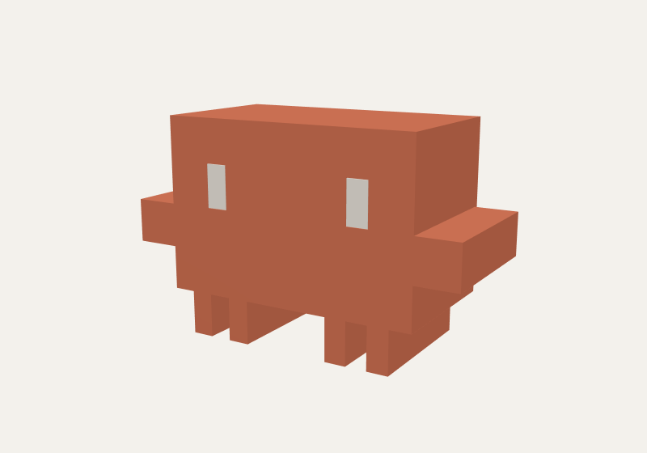

# Impressão 3D

O corpo é o mascote do Claude Code em pixel art, oco, com 128 × 80 × 53 mm montado (16 × 10 pixels de 8 mm). Os STL
estão em `3d/` e saem do script `3d/gerar.py`, já na posição de imprimir: **nenhuma peça precisa de suporte**.

<p align="center">
  
  
</p>

**Vídeo da montagem:** [`screenshots/montagem.mp4`](screenshots/montagem.mp4) (33 s) mostra cada peça entrando no lugar,
na ordem de montar.

## Peças

| Arquivo | Cor | Na mesa |
| --- | --- | --- |
| `corpo.stl` | Laranja | Com o rosto para baixo. O rosto pega a textura da mesa (numa PEI texturizada fica fosco e bonito) |
| `tampa-encaixe.stl` ou `tampa-parafusos.stl` | Laranja | Com o lado de fora para baixo (o berço do botão e o suporte da placa ficam em cima) |
| `difusores.stl` (os 2 olhos, ocos) | Branco | Com a aba para baixo |
| `tampas-dos-olhos.stl` (as 2) | Qualquer; branco reflete mais luz | Com a aba para baixo (o rebaixo dos LEDs fica em cima) |
| `trava-do-botao.stl` | Qualquer | Deitada |
| `trava-da-placa.stl` | Qualquer | Deitada, com as linguetas para cima |

**Duas tampas, o mesmo corpo:** a de encaixe tem quatro linguetas que estalam em rebaixos das paredes de dentro do
corpo; para abrir, ponha uma moeda na fenda embaixo, no meio da borda de trás, e levante. A de parafusos fecha com 4
parafusos M2 × 8 autoatarraxantes nas torres dos cantos, que continuam no corpo. Imprima uma das duas.

O corpo tem 128 × 80 × 51 mm na mesa e cabe em qualquer impressora, até numa de 180 × 180 mm.

**Tudo de uma vez:** `mesa.stl` traz as seis peças de um Companion lado a lado, com a tampa de encaixe, em 208 × 154 mm (cabe em qualquer
Anycubic Kobra, a partir de 220 × 220 mm). No fatiador (Anycubic Slicer Next, Orca, Bambu Studio), use **Dividir →
Para objetos** para separar as peças. Com multicor (o ACE da Anycubic), dê o branco aos difusores. Sem multicor,
imprima os difusores à parte, em branco, ou só a `mesa.stl` sem eles. Para 3 Companions, são 3 impressões: três corpos
não cabem juntos nem numa mesa de 250 mm.

## Material e cores

- **PLA fosco (matte)** em tudo: não empena, imprime fácil, e o fosco esconde as camadas, combinando com o pixel art.
  Se o Companion for ficar no sol ou num lugar quente, use PETG (o PLA amolece perto de 55 °C).
- **Corpo e tampa:** laranja terracota, o mais perto possível do laranja do mascote (`#D97757`). Procure por
  "terracota", "coral" ou "laranja queimado" fosco; laranja vivo demais fica parecendo cone de trânsito.
- **Difusores:** PLA **branco**, não o "natural" translúcido. Apagado, o olho fica branco, como você quer; aceso, o
  branco espalha a luz por igual. O difusor é oco, com 0,6 mm na frente (3 camadas) e 1,2 mm nos lados, então a luz
  passa de sobra. Se achar fraco, aumente o brilho no portal; se der para ver os dois LEDs como pontos, aumente `SKIN`
  no `gerar.py`.
- **Com impressora multicor** (AMS ou troca de filamento na camada), dá para imprimir os olhos brancos junto com o
  rosto, sem os difusores avulsos.

## Configurações

| Ajuste | Valor |
| --- | --- |
| Altura de camada | 0,2 mm (bico de 0,4 mm) |
| Paredes (perímetros) | 3 |
| Camadas de topo e de fundo | 4 |
| Preenchimento | 15%, giroide (só os braços e as pernas, que são maciços, usam) |
| Suportes | Nenhum |
| Brim | Não precisa |

As espessuras já vêm do modelo: paredes de 2,4 mm nos lados, no topo e no chão, e 2 mm no rosto e na tampa. Com 3
perímetros elas saem praticamente sólidas. A única ponte é a frente dos difusores, que são ocos (5,4 mm);
qualquer impressora faz.

## Onde vai cada componente

<p align="center">
  
</p>

Visto por trás, com a tampa aberta:

- **Olhos:** atrás de cada janela há um tubo de luz. Encaixe o difusor por dentro, com a aba para trás, e prenda a
  aba com uma gota de cola. Cada olho leva duas plaquinhas de LED WS2812B (de fita de 30 LEDs/m, 10 × 33 mm, um LED
  cada), deitadas, uma em cima da outra, coladas no rebaixo da tampinha com os LEDs virados para fora. Na de cima, a
  entrada (DIN) fica na ponta do canal dos fios, a que aponta para o meio do corpo; a de baixo vai girada, com a DIN
  na outra ponta, junto da DO da de cima: ligue as duas com três fios curtos (+5V com +5V, DO com DIN, GND com GND).
  Os três fios do olho saem pelo canal. Empurre a tampinha no tubo até a aba encostar: as nervuras seguram sem cola, e
  os LEDs ficam a uns 5 mm do difusor.
- **Fios dos olhos:** GPIO5 → olho que fica à esquerda de quem olha de frente; GPIO6 → o outro. Por trás, o olho do
  GPIO5 é o da direita.
- **Mini protoboard de 170 furos:** no chão, entre os dois trilhos. Com a tampa aberta, deslize a protoboard por
  trás, por baixo das abas dos trilhos, até encostar no rosto; fechada, a tampa a segura do outro lado. Os trilhos têm a
  largura da protoboard com os dentinhos de encaixe, com 0,3 mm de folga, e as abas cobrem 2,5 mm da borda sem furos:
  mesmo encostada num trilho, ela não sai de baixo da aba do outro. Deixe a fita dupla face com o papel protetor: a altura conta com ela, então a protoboard desliza sem grudar e fica sem folga.
  Os trilhos contam com uma de 48 × 36 × 9 mm (a largura com os dentinhos, a altura com a fita dupla face): se a sua for diferente, mude `PB` no
  `gerar.py`. Embaixo da SuperMini, os componentes podem ter até 8 mm de altura; no resto, até uns 17 mm.
- **ESP32-C3 SuperMini:** deitada no suporte da tampa, com o USB-C para fora. As pernas (a barra de pinos, até
  10 mm) descem dos lados do apoio do meio, que é o único que encosta na placa por baixo, e ficam acima dos
  componentes da protoboard. Ponha a placa por cima no fundo do suporte,
  encostada na parede de trás, e deslize até o USB-C entrar no furo: ele fica rente à tampa por fora, e o cabo encosta
  nela. Depois empurre a trava da placa por cima, entre a placa e a parede: ela segura a placa contra a tampa e, com as
  duas linguetas, por cima. O suporte conta com uma SuperMini de 18 × 22,52 mm, com 4 mm da base da placa ao topo do
  USB-C e o USB-C passando 1 mm da borda; se a sua for diferente, mude `MCU`, `MCU_PCB` e `USB_OVERHANG` no
  `gerar.py`.
- **Resistores e capacitor:** na protoboard.
- **Bateria** (só com o XIAO, que carrega bateria; a SuperMini não): em pé, na parede da esquerda, atrás do tubo do
  olho (a partir de uns 15 mm do rosto), com fita dupla face de espuma. Uma 803040 (8 × 30 × 40 mm, 1000 mAh) cabe com
  os 40 mm na vertical, entre a torre de baixo e a de cima. O suporte da tampa é do tamanho da SuperMini: para o XIAO
  (21 × 17,8 mm), mude `MCU`.
- **Buzzer:** colado na tampa, atrás dos furos do som (embaixo, à direita).
- **Botão:** uma chave táctil de 12 × 12 mm, só a chave, sem a plaquinha do módulo. Solde os fios antes de montar
  (depois as pernas ficam dentro do berço), em duas pernas em diagonal: assim pega os dois contatos, qualquer que seja
  o lado. Fio fino, de 26 a 28 AWG, sai fácil pelos rasgos dos lados do berço. Então encaixe a chave por dentro da tampa, no
  berço em cima à esquerda, com as pernas para os lados abertos do berço. Empurre a trava atrás dela até estalar: as
  nervuras a deixam justa, e os dois dentes entram nas janelas das paredes do berço, então apertar o botão (mesmo um
  duro) empurra a trava contra a parede, não para fora. Os entalhes deixam passar as pernas. Para tirar, aperte os
  dentes pelas janelas com uma chave de fenda pequena. Ponha a capa por fora, pelo furo. O furo conta com
  uma capa redonda de 13 mm; se a sua for de outro tamanho, meça e mude o `CAP_D` no `gerar.py`.
- **Tampa:** a de encaixe estala no lugar; a de parafusos leva 4 parafusos M2 × 8 autoatarraxantes.

## Protoboard ou placa soldada

A mini protoboard de 170 furos (48 × 36 × 9 mm, com a fita dupla face) cabe e é ótima para o protótipo, mas com o tempo os jumpers e os
componentes soltam. Para a versão final, solde tudo numa placa perfurada do mesmo tamanho. O suporte da placa fica
logo acima dela (`MCU_Y` no `gerar.py`).

## Mudar o tamanho

Os números ficam no começo do `3d/gerar.py`: `P` (tamanho do pixel), `D` (profundidade), `FACE`, `WALL` e `LID`
(espessuras). Depois de mudar:

```bash
uv run 3d/gerar.py
```

O script confere o tamanho de cada peça antes de salvar. Com o `D` menor que 53 mm, a protoboard (48 mm) não cabe
mais entre o rosto e a tampa.
